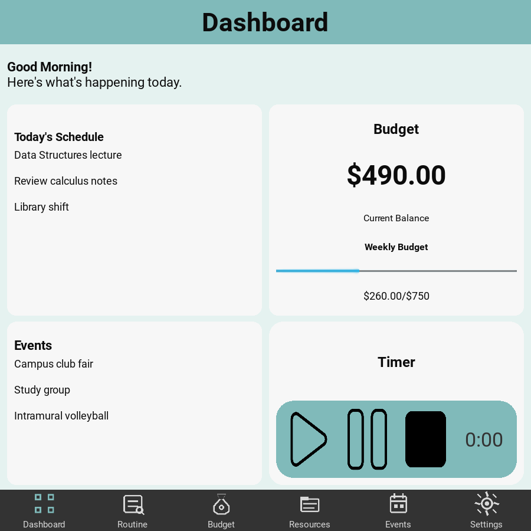
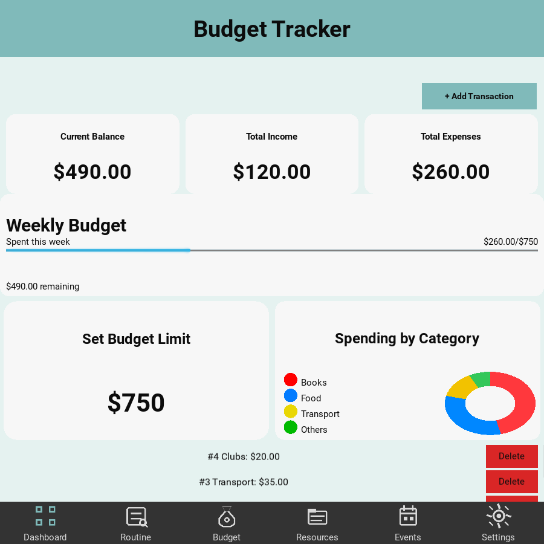
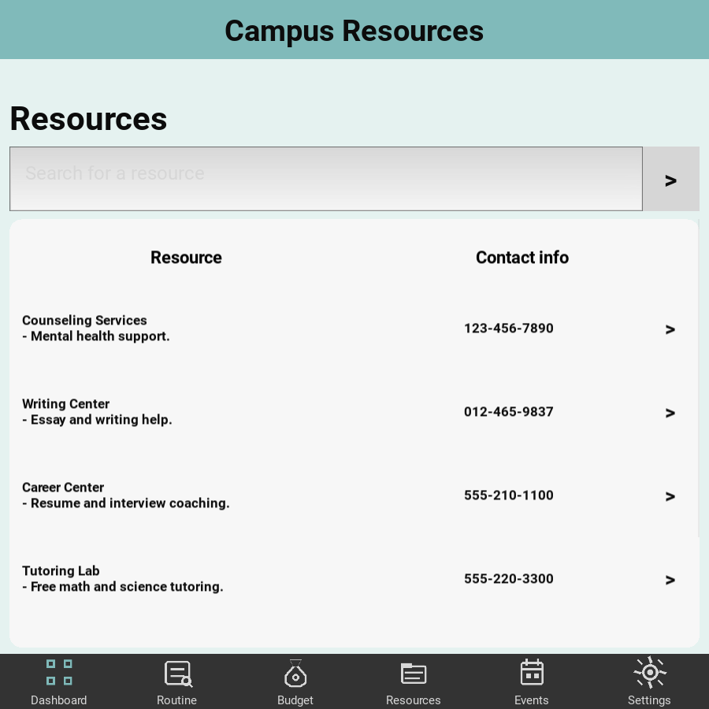
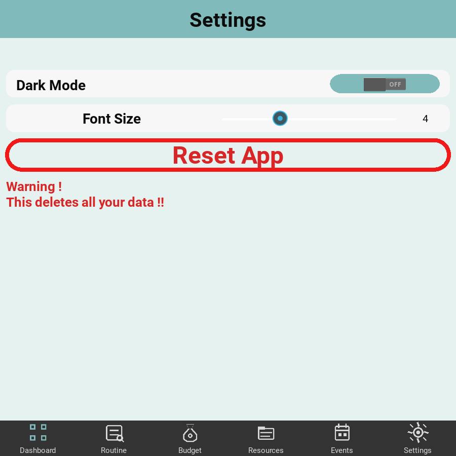

# College Life Management App

Keep your student schedule, spending, campus resources, and events in one place. College Life Management App is a **Python/Kivy desktop application** with local data storage and a built-in focus timer.

No account, API key, or backend server is needed. Once installed, the app runs offline.



## Features

| Section | What you can do |
| --- | --- |
| **Dashboard** | View a schedule preview, budget balance, and events; start, pause, or reset a focus timer. |
| **Weekly Routine** | Add and delete tasks by weekday, organized as Class, Study, Work, or Other. |
| **Budget Tracker** | Record expenses, set a budget limit, view recent transactions, and see spending by category. |
| **Campus Resources** | Search resource names, descriptions, and contact information, then open their details. |
| **Social Hub** | Create local events, view descriptions, and filter by student life, academics, or sports. |
| **Settings** | Switch dark mode, adjust font size, and reset app data. |

Tasks, expenses, events, and appearance preferences are saved between sessions.

## Screenshots

Screenshots use illustrative demo data.

| Weekly Routine | Budget Tracker |
| --- | --- |
|  |  |

| Social Hub | Campus Resources |
| --- | --- |
|  |  |

<details>
<summary>View settings</summary>



</details>

## Getting started

Install Git and official 64-bit **Python 3.12**. Python 3.11 is also part of the documented setup. The interface uses **Kivy 2.3.0**.

```bash
git clone https://github.com/SambhavPyakurel/CollegeLifeManagementApp.git
cd CollegeLifeManagementApp
```

### Windows PowerShell

```powershell
py -3.12 -m venv .venv
.\.venv\Scripts\python.exe -m pip install --upgrade pip
.\.venv\Scripts\python.exe -m pip install -r requirements.txt
.\.venv\Scripts\python.exe main.py
```

### macOS / Linux

```bash
python3.12 -m venv .venv
./.venv/bin/python -m pip install --upgrade pip
./.venv/bin/python -m pip install -r requirements.txt
./.venv/bin/python main.py
```

Run commands from the repository root so the app can find its layouts, images, and data. A graphical desktop session is required; a headless terminal alone cannot display the app window.

The commands use the virtual environment directly, so activation is optional. Windows startup has been verified with Python 3.12.14. macOS/Linux instructions have not been platform-tested.

## Try it out

1. Open **Routine**, choose a weekday, and add a class or study task.
2. Add an expense in **Budget**, then set your budget limit.
3. Create an event in **Events** and open its details.
4. Search for a service in **Resources**.
5. Start a focus session from the dashboard and adjust your preferences in **Settings**.

## Local storage

The app saves state to **`data/app_state.json`**. To back up your data, close the app and copy that file. Restore a backup by replacing it while the app is closed.

**Reset App** immediately restores defaults. The JSON file is plain text and tracked in the repository, so review it before committing personal schedules or expense data. Timer progress is not saved.

## Current scope

- Resource contacts and starter events are sample content, not a live campus directory or feed.
- Budget totals include all recorded expenses. The “Weekly Budget” label does not yet apply a date filter, and the income card is a fixed `$120` placeholder.
- Routine tasks are grouped by weekday across stored dates. New events use today's date.
- The app stores data on one device; there is no cloud sync or notification service.

## Project structure

```text
CollegeLifeManagementApp/
├── main.py             # App startup, navigation, theme, and scaling
├── screens/            # Screen behavior and actions
├── kv/                 # Kivy layout files
├── app/widgets/        # Reusable buttons, navigation, and charts
├── services/           # Data model and JSON storage
├── assets/             # Interface icons and images
├── data/app_state.json # Saved state and starter content
├── docs/images/        # Screenshots
└── requirements.txt    # Kivy dependency
```

## Troubleshooting

- **Kivy installation fails:** Use official 64-bit Python 3.12 or 3.11 with a fresh virtual environment. Python 3.13+ is not the documented setup for the pinned Kivy version.
- **Missing module:** Install dependencies with the same interpreter used to launch the app.
- **Missing layouts or images:** Change into the project root before running `main.py`.
- **Controls do not fit:** Resize the window or reduce the font-size setting.
- **Invalid saved JSON:** Back up `data/app_state.json`, then move it out of the data folder to start with defaults.

Prefer the explicit `.venv` launch commands above. The optional `run_app.ps1` helper selects a Codex-bundled interpreter first when present, which may not have this project's dependencies installed.
