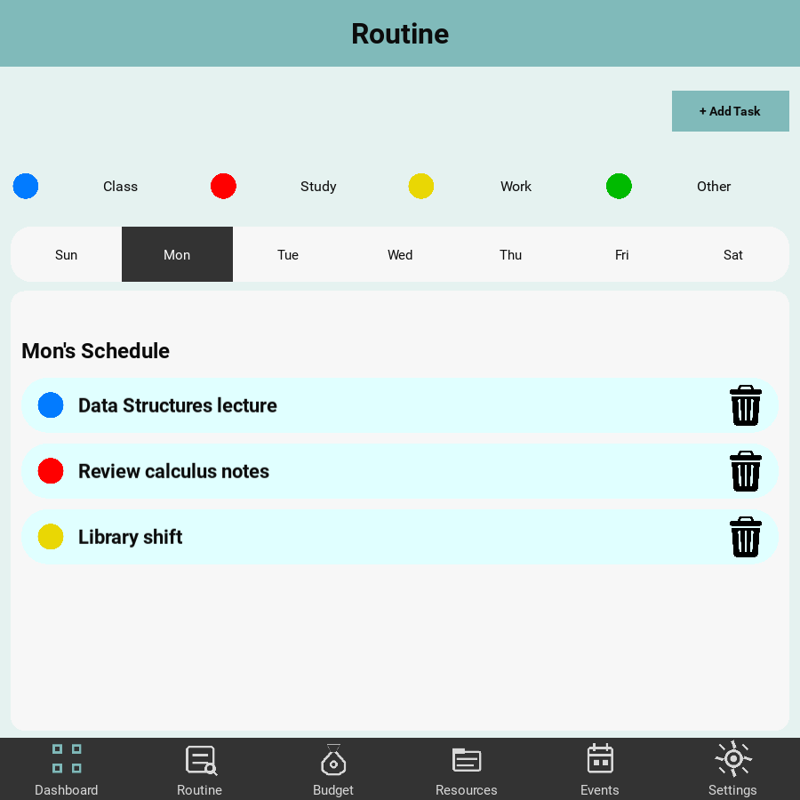
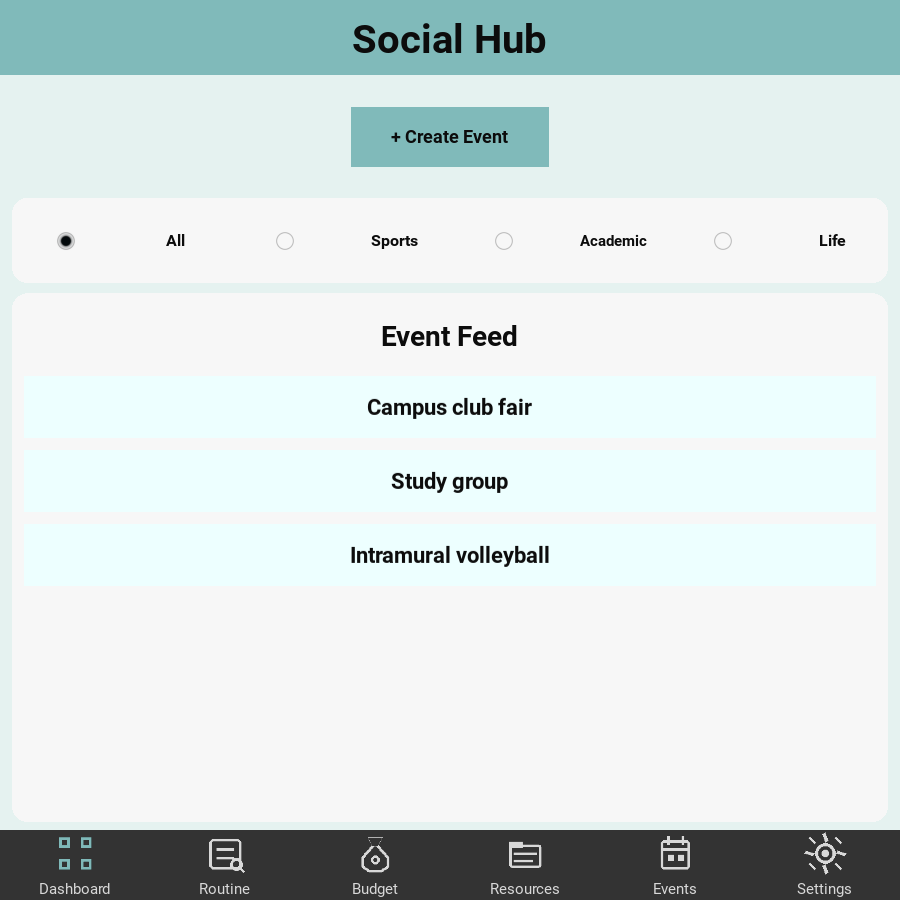

# College Life Management App

A Python/Kivy desktop app that brings a student's schedule, spending, campus resources, social events, and focus timer into one place. Data is stored locally in JSON, so no account, API key, or backend server is required.

## What it does

| Section | Features |
| --- | --- |
| **Dashboard** | A schedule preview, remaining budget and spending progress, event preview, and a count-up focus timer with start, pause, and reset controls. |
| **Weekly Routine** | Select a weekday; add and delete tasks categorized as Class, Study, Work, or Other. New tasks receive the next matching date, including today. |
| **Budget Tracker** | Add and delete expenses, set a budget limit, see remaining funds and total expenses, and visualize spending by category with a doughnut chart. The history displays the five most recent transactions. |
| **Campus Resources** | Search resource names, descriptions, and contact information, then open a resource's details. Includes sample counseling, writing, career, tutoring, library, and IT entries. |
| **Social Hub** | Create local events with a title, description, and category; browse event details and filter by student life, academics, or sports. |
| **Settings** | Save dark mode and font-size preferences, or reset local app data to defaults. |

## Screenshots

Actual application renders with illustrative demo tasks, expenses, and events. These screenshots do not represent live campus data. The Budget Tracker's $120 income value is a placeholder (see limitations below).

| Dashboard | Weekly Routine |
| --- | --- |
|  |  |

| Budget Tracker | Social Hub |
| --- | --- |
|  |  |

| Campus Resources | Settings |
| --- | --- |
|  |  |

## Technology

- **Python 3.12 recommended**; the previous setup also documents Python 3.11.
- **Kivy 2.3.0** for the desktop GUI, screen navigation, graphics, and timer scheduling.
- **KV layout files** separate screen layouts from Python behavior.
- **Python dataclasses and JSON** represent and persist application state.
- Custom widgets provide navigation icons, auto-fitting buttons, and the spending chart.

Startup and all six main screen renders were verified on Windows with Python **3.12.14** and Kivy **2.3.0**. macOS/Linux instructions below have not been runtime-tested as part of this README update.

## How to run

### Prerequisites

Install [Git](https://git-scm.com/downloads) and official 64-bit [Python 3.12](https://www.python.org/downloads/). Use a desktop environment capable of opening a graphical window. An internet connection is needed to download the source and dependencies; normal app use is offline.

### 1. Download the project

```bash
git clone https://github.com/SambhavPyakurel/CollegeLifeManagementApp.git
cd CollegeLifeManagementApp
```

Run all remaining commands from this project directory. The app resolves its layouts, assets, and saved data relative to the working directory.

### 2. Create an environment and install dependencies

**Windows PowerShell**

```powershell
py -3.12 -m venv .venv
.\.venv\Scripts\python.exe -m pip install --upgrade pip
.\.venv\Scripts\python.exe -m pip install -r requirements.txt
```

If Python 3.11 is installed instead, replace `py -3.12` with `py -3.11`.

**macOS / Linux**

```bash
python3.12 -m venv .venv
./.venv/bin/python -m pip install --upgrade pip
./.venv/bin/python -m pip install -r requirements.txt
```

These commands use the virtual environment directly, so shell activation is optional.

### 3. Start the app

**Windows PowerShell**

```powershell
.\.venv\Scripts\python.exe main.py
```

**macOS / Linux**

```bash
./.venv/bin/python main.py
```

A desktop window titled **College Life App** opens. Use the bottom navigation to switch sections.

The repository also includes `run_app.ps1`, but it prefers a Codex-bundled Python installation over `.venv` when one exists. The explicit commands above ensure that you run the interpreter where you installed Kivy.

### Try it out

1. Open **Routine**, choose a weekday, and add a class or study task.
2. Open **Budget**, add an expense, and set a budget limit to see the totals and chart update.
3. Open **Events**, create an event, and view its details.
4. Search for `writing` or `tutoring` in **Resources**.
5. Start and pause the dashboard timer, then try dark mode in **Settings**.
6. Close and reopen the app to check that tasks, expenses, events, and preferences remain saved. Timer progress is not saved.

### Troubleshooting

- **`py` or `python3.12` not found:** Install Python 3.12, reopen the terminal, and verify the installed interpreter. On Windows, `py -0p` lists registered installations.
- **`No module named kivy`:** Install requirements with the same `.venv` interpreter used to launch the app.
- **Kivy tries to compile or fails to build:** Prefer official 64-bit CPython 3.12 or 3.11 for this pinned dependency. Python 3.13+ and MSYS2/MinGW Python are not the documented setup for this project. Create a fresh environment with the supported interpreter.
- **Missing KV files or images:** Change into the repository root before launching.
- **Linux graphics errors:** Depending on the distribution, SDL2/OpenGL libraries may be needed. On Ubuntu/Debian, the original setup suggests `sudo apt install libgl1 libmtdev1 libsdl2-2.0-0`. A headless terminal or Codespaces session alone will not display the desktop window; a graphical session is also required.
- **Text or controls do not fit:** Resize the window or lower the font-size setting. Some layouts may still need adjustment at smaller window sizes.
- **Invalid JSON on startup:** Back up `data/app_state.json`, then move it outside the `data` folder to start with defaults. The app does not currently recover automatically from malformed saved data.

## Local data

Saved state lives in `data/app_state.json` and includes tasks, transactions, the budget limit, resource entries, events, and settings. The repository includes starter data, so the first launch may show sample events with older dates.

To back up your data, close the app and copy this file. To restore it, close the app and replace the file with your backup. **Reset App** in Settings immediately replaces saved state with defaults, including sample resources and events; there is no confirmation dialog.

The JSON file is plain text and is currently tracked by Git. Review changes before committing so personal schedules or financial entries are not accidentally published.

## Project structure

```text
CollegeLifeManagementApp/
|-- main.py                    # App startup, screen registration, theme and scaling
|-- requirements.txt           # Pinned Kivy dependency
|-- run_app.ps1                # Optional Windows launcher
|-- screens/                   # Screen behavior and user actions
|-- kv/                        # Declarative screen layouts
|-- app/widgets/               # Reusable buttons, navigation, and chart widgets
|-- services/
|   |-- models.py              # AppState dataclass and defaults
|   `-- storage.py             # JSON loading, normalization, saving, and reset
|-- assets/                    # UI icons and images
|-- data/app_state.json        # Local saved state and starter content
`-- docs/
    |-- images/                # README screenshots
    `-- capture_screenshots.py # Reproduce renders with in-memory demo data
```

To regenerate the screenshots, run `.\.venv\Scripts\python.exe docs\capture_screenshots.py` on Windows, or `./.venv/bin/python docs/capture_screenshots.py` on macOS/Linux, from the project root. This opens the app, renders six screens, and exits. Demo data is held in memory and does not overwrite the saved JSON file.

## Current scope and limitations

This is a functional student portfolio prototype with several areas still open for development:

- **Budgeting:** The income card is hard-coded to `$120.00`. Remaining funds are calculated as budget limit minus expenses; there is no income-entry feature. Although the UI says "Weekly Budget," transactions have no dates and totals include all stored expenses, with no weekly reset or date filtering.
- **Schedules:** The routine view groups tasks by weekday across stored dates, rather than a specific calendar week. There is no task-completion control or reminder notification. The dashboard falls back to other stored tasks when there are no tasks due today.
- **Events:** Events are local records, not a shared campus feed. New events use today's date; there is no date picker. The dashboard shows the first three stored events without filtering past dates.
- **Resources:** Names, descriptions, and phone numbers are sample content, not verified campus contact information.
- **Validation and reliability:** Input validation is basic; invalid expense text becomes zero, and negative amounts are not explicitly rejected. Storage does not include encryption, atomic writes, or automatic recovery from damaged JSON.
- **Distribution:** There is no login, cloud sync, packaged installer, or mobile build configuration. No automated test suite is currently included.

Useful next steps include stronger input validation, dated transactions and true weekly totals, editable event dates, storage tests, and a packaged desktop release.

## Can this go on my resume?

**Yes—as a Python desktop application or student software project**, provided you can explain the implementation and accurately describe your own contribution. It demonstrates multi-screen GUI development, reusable widgets, event-driven programming, data visualization, and persistent local storage.

Suggested resume entry (adjust it to match the work you personally completed):

**College Life Management App | Python, Kivy, JSON**

- Built a six-section desktop application for student routines, expense tracking, local events, and campus resource lookup, with JSON persistence, category-based spending visualization, a focus timer, and saved appearance preferences.

Describe it as a local desktop prototype. Avoid claiming real campus integration, production deployment, user adoption, or measured performance improvements without evidence. Adding automated tests, stronger validation, and a downloadable release would make it a stronger portfolio project.
